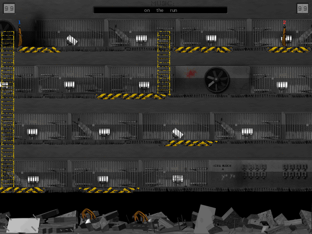

# Cell Block A

A native reconstruction of **Cell Block A 1.3b (February 4, 2000)**, the two-player platform fighting game created by **Jacob Schwartz in 1999** with Allegro and DJGPP. Includes a native port of **Jail-ed 1.1b**, the original map editor.

Fight your opponent with weapons, fists, or a well-timed shove off a platform. Both players share one keyboard. This project recovers the original C/C++ game logic and reuses the original graphics, maps, fonts, sound effects, and tracker music. It compiles to a native application; no DOS emulator is used.



**[Download prebuilt game and editor apps](https://github.com/isoiphone/CellBlockA/releases/tag/native-v1.3.0-preview.1)** for Windows x64, macOS 15+ (Apple Silicon or Intel), and Linux x64. The native preview includes source and SHA-256 checksums. No compiler is needed to run the downloads; Linux requires the system SDL2 runtime and Zenity for editor file dialogs.

## Status

The goal is to preserve the original game, not redesign it. Two original memory-safety bugs are deliberately fixed: collision checks outside the map return empty space, and redraw requests are clipped to valid tiles.

| Platform | Build/run path | Verification so far |
| --- | --- | --- |
| macOS, Apple Silicon | Shell build; standalone `.app` | Game/editor built and sanitizer-tested; editor mouse/save/load checked interactively; edited maps tested in the game on macOS 26 |
| macOS, Intel | Shell build; standalone `.app` | CI sanitizer, packaged gameplay and editor integration tests pass |
| Windows 10/11, x64 | Python build; portable `.exe` package | Native CI regression, packaged gameplay and editor integration tests pass |
| Linux, x64/arm64 | Shell build with system SDL2 | Ubuntu x64 CI sanitizer, packaged gameplay and editor integration tests pass; arm64 remains unverified |

Audio mixing, timing, and some platform behavior are not certified identical to the DOS release. **Jail-ed 1.1b**, the editor from the 1.3b distribution, is also ported to native source. It preserves the original canvas, tools, cursors, artwork and map format. See the [editor guide](docs/JAILED.md) and [fidelity record](docs/FIDELITY.md).

## Programs and packages

Both programs are available on macOS, Windows, and Linux:

| Platform | Cell Block A | Jail-ed |
| --- | --- | --- |
| macOS | `CellBlockA-macOS-<architecture>.zip` → `Cell Block A.app` | `Jailed-macOS-<architecture>.zip` → `Jail-ed.app` |
| Windows x64 | `CellBlockA-Windows-x64.zip` → `CellBlockA.exe` | `Jailed-Windows-x64.zip` → `Jailed.exe` |
| Linux | `CellBlockA-Linux-<architecture>.tar.gz` → `CellBlockA` | `Jailed-Linux-<architecture>.tar.gz` → `Jailed` |

Each editor download includes its required resources and notices. The Windows and Linux game downloads also include Jail-ed for convenience. Extract the entire package before launching. Both programs share the same user map folder.

## Build and run

Download this repository's source ZIP and extract it, or clone it, then open a terminal in its root directory. Normal builds do **not** need Ghidra, Java, Allegro, or DJGPP. Generated binaries are not committed; builds create them under `build/` and `dist/`.

### macOS

Install Apple's command-line tools and the SDL dependencies using [Homebrew](https://brew.sh/):

```sh
xcode-select --install
brew install python sdl2-compat sdl3
./tools/package.sh
open "dist/Cell Block A.app"
open "dist/Jail-ed.app"
```

The package includes SDL. It is built for the Mac's CPU architecture; its minimum macOS version is derived from the executable and bundled libraries. Local packages are ad-hoc signed, not notarized. [Detailed build instructions](docs/BUILDING.md#macos).

### Windows

Install [Python 3.9 or newer](https://www.python.org/downloads/windows/), then run in PowerShell:

```powershell
py -3 tools/build_windows.py --test
.\dist\CellBlockA-Windows-x64\CellBlockA.exe
.\dist\Jailed-Windows-x64\Jailed.exe
```

The script downloads pinned, SHA-256-verified compiler and SDL packages, compiles the game and Jailed.exe, runs the Windows tests, and creates both portable ZIPs. Visual Studio and MSYS2 are not required. [Windows instructions](docs/WINDOWS.md).

### Linux

On Ubuntu/Debian:

```sh
sudo apt update
sudo apt install clang python3 libsdl2-dev zenity
./tools/build.sh
./build/CellBlockA
./build/Jailed
```

Run the game in a desktop session. Other distributions need equivalent C/C++17, Python 3.9+, and SDL2 development packages. `./tools/package.sh` creates game and standalone editor archives that use the system SDL2 runtime. Zenity provides the editor’s file dialogs. [Linux instructions](docs/BUILDING.md#linux).

## Controls

| | Movement | Action |
| --- | --- | --- |
| Player 1 | W, A, S, D | Q |
| Player 2 | Arrow keys | Control |

Menus use arrows and Enter. Escape leaves a match/menu. Music uses the **numeric keypad**: Num Lock chooses a random track, `/` previous, `*` next, `-` pause/resume, and `+` stop/start. No laptop-specific remapping has been added.

See [playing and troubleshooting](docs/PLAYING.md) for launch instructions, settings locations, and sound troubleshooting, or the unchanged [1.3b manual](original-1.3b/README.TXT).

## Development

```sh
./tools/test.sh                       # macOS/Linux sanitizer tests
python3 tools/check_repo.py           # source hashes and repository checks
python3 tools/export_source.py        # clean native-game source archive
python3 tools/test_source.py          # verify the archive in isolation
```

On Windows, `py -3 tools/build_windows.py --test` builds and runs its native tests. Headless tests and packaging pass on [Windows](https://github.com/isoiphone/CellBlockA/actions/runs/39007043354), [Ubuntu, and Intel/Apple Silicon Macs](https://github.com/isoiphone/CellBlockA/actions/runs/39007043357). These checks do not replace testing real graphics, audio, or two-player input.

- [Build reference](docs/BUILDING.md)
- [Contributing](CONTRIBUTING.md)
- [Recovery/source layout](docs/RECOVERY.md)
- [Release process](docs/RELEASING.md)
- [Changes](CHANGELOG.md)

## Historical preservation

The original websites are preserved in [`www/1999`](www/1999/index.html) and [`www/2001`](www/2001/index.html). Open [`www/index.html`](www/index.html) to choose a version; both work offline. See the [website preservation notes](www/README.md) for sources, documented gaps, and verification.

The original DOS game and map editor are preserved in [a 1.3b ZIP](archives/CellBlockA-1.3b.zip) and [a 1.0 reference ZIP](archives/CellBlockA-original.zip), with [archive details](archives/README.md). These ZIPs are newly assembled from unchanged historical files. The native build uses `original-1.3b/`; `original/` retains the earlier 1.0 distribution for research.

## License and credits

Jacob Schwartz created the original game code, artwork, and sound effects. Their licenses are:

- **Code: [MIT](LICENSE)** — the author-owned game and editor code, native ports, build/test/recovery tools, and new documentation.
- **Assets: [CC BY-SA 4.0](ASSET_LICENSE.md)** — Creative Commons Attribution-ShareAlike 4.0 International, for Jacob Schwartz’s artwork, maps, and sound effects, with attribution to him.
- **MOD music: excluded from both licenses.** It was obtained elsewhere and was not created by Jacob Schwartz. This exclusion includes instrument samples embedded in the MOD files; their respective copyright holders retain their rights.

Third-party libraries and library-derived material retain their own terms. See [third-party notices and license scope](THIRD_PARTY_NOTICES.md).

Redistribution records for the bundled music and the historical JGMOD registration condition remain unresolved. See the [outstanding release gates](docs/RELEASING.md#outstanding-release-gates) before publishing the complete bundle. These materials are not covered by the project's MIT or CC BY-SA grants.

Original credits include Dustin Schwartz & Jacob Schwartz (concept/story), Jacob Schwartz (art and sound effects), the original musicians, Allegro, JGMOD, Red Pixel, and the Lake St School play testers. The 1.3b manual also credits Thomas Craft and David Bronough for vocals. Full historical credits remain unchanged in the [1.3b manual](original-1.3b/README.TXT).
